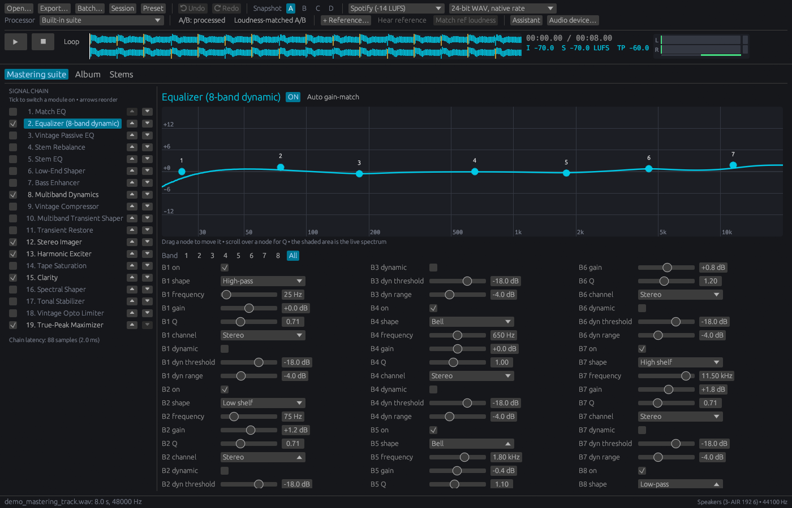

# Mastering Studio

A standalone audio mastering workstation for Windows, written in Rust. Its built-in mastering suite covers EQ, dynamics, stereo, saturation, spectral and stem-aware processing, limiting, metering, referencing, album sequencing and export. It needs no external plugins. VST3 plugins can still be loaded, but only as optional fallback processors.



---

## ✨ Features

### Built-in mastering suite

A chain of 19 modules. Each one can be switched on or off independently, and the chain can be reordered freely. Every parameter is editable, and the whole chain is saved in presets.

| Module | What it does |
|---|---|
| **Equalizer (8-band dynamic)** | HP / shelves / bells / LP. Each band can be Stereo, Mid or Side, with optional dynamic gain. |
| **Vintage Passive EQ** | Passive-style program EQ: simultaneous low boost and cut, broad high boost, high shelf cut, transformer drive. |
| **Match EQ** | Learns the tonal balance of a reference track and applies the difference. Adjustable smoothing, amount and maximum correction. |
| **Stem EQ** | Separate low / mid / high EQ for vocals, bass, drums and other. |
| **Stem Rebalance** | Turn vocals, bass, drums or everything else up or down inside a finished mix. |
| **Low-End Shaper** | Adds punch to, or smooths, kick and bass transients below an adjustable cutoff. |
| **Bass Enhancer** | Tightens and boosts the sub band, adds harmonics so bass translates on small speakers, and can make the low end mono. |
| **Multiband Dynamics** | 4-band compressor with per-band threshold, ratio, attack, release and makeup. |
| **Vintage Compressor** | Feedback compressor with soft knee, program-dependent release, sidechain HPF, parallel mix, and Clean / Warm / Vari-Mu characters. |
| **Multiband Transient Shaper** | Per-band punch (accent or soften attacks) with adjustable crossovers. |
| **Transient Restore** | Brings back attacks that heavy limiting has flattened. |
| **Stereo Imager** | Overall width, 4-band width, mono-maker, and Stereoize for narrow sources. |
| **Harmonic Exciter** | Warm / Tube / Tape / Crisp saturation above an adjustable frequency. |
| **Tape Saturation** | 15 / 30 ips machine model: emphasis, hysteresis-flavoured saturation, head bump, HF roll-off, bias. |
| **Clarity** | Dynamic resonance smoothing around a focus frequency. |
| **Spectral Shaper** | Tames narrow spectral peaks (harshness, sibilance) relative to the local spectral average. |
| **Tonal Stabilizer** | Slowly steers the long-term tonal balance toward a Flat / Warm / Balanced / Bright target. |
| **Vintage Opto Limiter** | Smooth, program-dependent limiting with Analog / Tube / Modern colour and a hard ceiling. |
| **True-Peak Maximizer** | 2 ms lookahead limiter with 4× true-peak detection and adaptive release. |

**AI stem separation.** Stem Rebalance and Stem EQ start as real-time approximations (spectral stem masks). Click **Separate stems (AI)** in either module and the bundled HTDemucs model splits the track into drums, bass, other and vocals in the background (on a CPU it takes about as long as the track plays). From then on both modules work on the real stems, during playback and export, with no added latency. The stem mixer's Auto-Separate uses the same model. See [`models/README.md`](models/README.md) for the model's origin and licence.

**Oversampling.** Modules that generate harmonics (Exciter, Tape, Vintage Compressor, Opto Limiter, Bass Enhancer, Passive EQ) run at 2x by default, and every such module (plus the Maximizer) can be set to off, 2x or 4x in its header. Linear-phase half-band filters remove the harmonics that would otherwise alias back into the audible band. On a hard-clipped 9.7 kHz tone, aliases drop from −14 dB to −73 dB. Oversampling adds 24 samples (2x) or 36 samples (4x) of latency, which is compensated like everything else.

**Phase-coherent multiband.** Multiband Dynamics, the Multiband Transient Shaper and the Stereo Imager split with Linkwitz-Riley crossovers whose bands are all-pass compensated, so with neutral settings they sum flat (within ±0.001 dB).

All DSP modules are original implementations. The spectral modules (Match EQ, Stem EQ, Stem Rebalance, Spectral Shaper, Tonal Stabilizer) share one streaming FFT engine (2048-point, 75% overlap) that reconstructs the signal exactly at neutral settings.

**Shared spectral pass.** Neighbouring spectral modules (with only switched-off modules between them) run in one shared pass: one analysis, each module's processing on the same spectrum in chain order, then one resynthesis. Stem Rebalance and Stem EQ also share their stem masks. A pass adds 2048 samples of latency however many modules it holds, so the default order with all five on costs 2 × 2048 samples instead of 5 × 2048. With every module switched on, CPU use drops from about 12% of a core to about 9%. The sound matches running the modules one after another (38 dB SNR with every module set off neutral, and bit-exact at neutral settings). A module with auto gain-match keeps its own FFT, because gain-matching measures its own input and output. The editor shows the chain latency and how many modules share a pass, and exports compensate for it.

### Honest comparisons

- **Loudness-matched A/B (`G`):** the processed signal plays back at the input's loudness, so a louder master can't win a comparison just by being louder. The correction is shown in the meter line (monitoring only; exports are unaffected).
- **Per-module auto gain-match:** the **Auto gain-match** button on each module measures loudness before and after it and trims its output, so tweaking or toggling a module changes tone rather than level.

### Working in the suite

- **Signal chain (left):** tick a module to switch it on, click its name to edit it, and use the arrows to reorder. The chain's total latency is shown underneath.
- **Module editor (right):** every parameter as a slider, checkbox or menu. Modules with dynamics show live gain-reduction meters.
- **Equalizer:** an interactive curve over the live spectrum. Drag a band's node to move its frequency and gain, scroll over it to change Q, and pick a band to show only its controls.
- **Auto gain-match** and **Learn from reference track** (Match EQ) / **Separate stems (AI)** (Stem Rebalance, Stem EQ) sit in each module's header.
- **MIDI learn:** right-click any parameter name, choose *MIDI learn*, then move a controller. Mapped parameters are highlighted.

### Undo, snapshots and sessions

- **Undo / redo** (`Ctrl+Z` / `Ctrl+Y`) covers every suite change: parameters, module on/off, chain order, auto gain, presets, the Assistant, reference matching, loudness targets and Match EQ learning. A slider drag or wheel spin counts as one step.
- **Snapshots A/B/C/D** (`Ctrl+1`–`Ctrl+4`) hold four complete chain settings for comparison. Switching away keeps your edits in that slot; right-click a slot to copy the current settings into it.
- **Sessions** (`.mstsession`, `Ctrl+S`) save the track and reference paths, the full suite, the snapshots, trim and fades, loudness-matched A/B, the album and the export and target choices.

### Workflow

- **Transport:** play / pause / stop / loop, a waveform overview with click-to-seek and scrubbing, and a time counter.
- **Metering:** peak / RMS VU, integrated / short-term / momentary LUFS, true peak, phase correlation, and a spectrum analyzer.
- **Referencing:** A/B against a reference track, with automatic loudness matching.
- **Loudness targets:** Spotify / Apple / YouTube / CD-club / broadcast. The target sets the maximizer drive and ceiling.
- **Master Assistant (`A`):** analyses the track in the background (loudness, loudness range, peak-to-loudness ratio, tonal balance in seven bands relative to pink noise, low-end phase, stereo width, static resonances). It then suggests and applies a chain aimed at a **genre profile** (Balanced, Pop, Hip-hop / R&B, Electronic, Rock, Acoustic, Jazz, Classical). The suggestions are EQ moves that correct half of each difference (at most ±3 dB) and a notch on any resonance; the Vintage Compressor for over-dynamic mixes or Transient Restore for squashed ones; the Spectral Shaper for bright mixes; the Bass Enhancer for a thin sub; and width, mono-maker and exciter settings to suit the genre. With **Match reference** ticked and a reference track loaded, the reference becomes the target instead: Match EQ learns its tone, and its dynamics and stereo width set the goals. The report explains each choice, and the result is a single undo step.
- **Match reference (AI):** with a track and a reference loaded, searches for the suite settings that make the track sound like the reference, then applies them as a single undo step and lists what changed. A style model (AFx-Rep, bundled, runs on the CPU) only scores how close candidates sound; the suite's own modules do the processing. The search covers the EQ, Vintage Compressor, Stereo Imager, Harmonic Exciter and Maximizer drive, holds the ceiling at the loudness target, and takes a minute or two. **Only adjust enabled modules** keeps it away from modules you've switched off. It sits next to Match EQ's *Learn from reference track* (tone only) and the Master Assistant (rule-based), and neither changes.
- **Trim & fades:** set in/out points at the playhead, with S-curve, exponential or linear fades.
- **Album montage:** sequence tracks with pregaps, balance loudness, reorder / skip / remove tracks, play the whole album through the chain, and export one mastered WAV plus a CUE sheet. Tracks at other sample rates are resampled.
- **Stem mixer:** split a track into 6 stems (or load stem files) and remix gain / pan / mute / solo.
- **Export:** WAV (16-bit, 24-bit or 32-bit float, with BWF metadata), FLAC (16- or 24-bit), MP3 (320 / 192 kbps) and AAC in .m4a (192 / 128 kbps), with optional sinc resampling. Integer formats get dither (noise-shaped for 16-bit, TPDF for 24-bit and for lossy encoders). Latency is compensated. MP3 and AAC use the encoders built into Windows (Media Foundation), loaded at run time; on Windows N editions without the Media Feature Pack those formats report that they are unavailable. Lossy files are written at 44.1 or 48 kHz. The album export (with CUE sheet) and batch processing of whole folders use the same formats.
- **QC report:** every export is decoded and checked. The report covers integrated loudness against the target, loudness range, maximum momentary and short-term loudness, 4× oversampled true peak and inter-sample overs, clipping (runs of full-scale samples), phase correlation (overall and worst 400 ms), mono fold-down loss, DC offset, and silence at each end. Each check is marked PASS, WARN or FAIL. The report opens in a window and is saved next to the file as `<name>.qc.txt`; a batch reports how many files QC flagged. Lossy files are measured as decoded, so overs added by the encoder show up.
- **Codec preview (`P`):** with an MP3 or AAC export format selected, **Codec preview** renders the master, encodes and decodes it, and lines it up with the master (encoder delay is detected automatically). The transport then switches between **Master**, the **codec** version and the **Difference** (what the encoder throws away) at the same playhead position. The status line shows the codec's true peak against the master's and how far below the master the difference sits. If the chain changes afterwards, the preview is flagged as out of date.
- **Presets:** `.xml` presets hold the chain order, every module's state and parameters, and any learned Match EQ curve. Factory presets in the element/param XML layout can also be imported.
- **Drag and drop** audio files onto the window. Dropped files are added to the album in montage mode.
- **MIDI control:** CC 1 drives the exciter, CC 7 maximizer drive, CC 10 stereo width, CC 64 play/pause and CC 80 the reference, plus notes 36 / 38 / 40 / 41 for play, stop, reference and bypass. Learned mappings override these.
- **Audio device:** pick the driver, output, sample rate and buffer size (**Audio device…**, `H`). The track, suite, plugin and stems carry over. ASIO is available when built with `--features asio` (needs Steinberg's ASIO SDK: set `CPAL_ASIO_DIR`, and install LLVM for bindgen).

### Fallback VST3 hosting (optional)

Choose **Load VST3 plugin (fallback)...** in the processor list, or pick a plugin found in `C:\Program Files\Common Files\VST3` or a `plugins` folder next to the executable. The plugin runs at the device rate, its editor opens in its own window (**Plugin editor** reopens it), and its state can be saved and loaded as `.vststate`. The host implements the standard VST3 interfaces and is tested with third-party plugins. The built-in suite is always the default; nothing in the app depends on a plugin being installed.

---

## ⌨️ Keyboard shortcuts

| Key | Action |
|---|---|
| `Space` | Play / pause |
| `Esc` | Stop and rewind |
| `←` / `→` | Scrub ±5 s |
| `B` | A/B: processed vs. dry |
| `G` | Loudness-matched A/B on/off |
| `L` | Loop |
| `R` | Toggle reference track |
| `A` | Master Assistant |
| `T` | Cycle loudness target |
| `D` | Cycle export format |
| `P` | Codec preview: build it, then cycle master / codec / difference |
| `M` | Album montage |
| `S` | Stem mixer |
| `H` | Audio device info |
| `[` / `]` | Trim in / out at playhead |
| `F` / `C` | Cycle fades / clear trim and fades |
| `Ctrl+O` / `Ctrl+E` / `Ctrl+S` | Open track / export / save session |
| `Ctrl+Z` / `Ctrl+Y` | Undo / redo |
| `Ctrl+1`–`Ctrl+4` | Snapshot A–D |
| Waveform | Click/drag to seek • Shift+click sets trim in • right-click sets trim out |

---

## 🚀 Building and running

Requires the Rust MSVC toolchain and [Git LFS](https://git-lfs.com) (for the model file). The first build downloads a prebuilt ONNX Runtime through the `ort` crate.

```powershell
cargo build --release
.\target\release\mastering_studio.exe
```

Pass an audio file path as the first argument to open it on launch. `--screenshot out.png [--view suite|album|stems] [--module equalizer]` renders the window to a PNG and exits (used for docs and UI checks; it never starts playback). `install_shell_context_menu.reg` adds a "Master with Mastering Studio" entry to Explorer; edit the paths in it if your checkout is not at `D:\dev\ozone clone`.

### Tests

```powershell
cargo test -- --test-threads=1
```

Highlights: golden-audio regression tests (`tests/golden/`; re-record after an intended change with `UPDATE_GOLDEN=1 cargo test --test golden_test`), aliasing and latency checks for oversampling, flatness checks for the crossovers, a check that a shared spectral pass sounds like separate modules, FLAC / MP3 / AAC round trips, QC measurements against reference signals (EBU 1 kHz tone, inter-sample peaks, loudness range), and Assistant suggestions per genre and per reference. The MP3 / AAC tests skip themselves where Media Foundation is missing.

The fallback-plugin tests only run when `MASTERING_STUDIO_TEST_VST3` points at a `.vst3` file (e.g. any installed third-party plugin); otherwise they skip. `engine_realtime_test` needs an audio output device, and `ml_separation_test` needs the model file.

### Benchmark

```powershell
cargo run --release --example bench_modules
```

This prints each module's CPU load at 48 kHz stereo. Every module runs far faster than real time; the default chain uses about 1.3% of one core, and all 19 modules together about 9% (neighbouring spectral modules share one FFT pass).

### Continuous integration

GitHub Actions (`.github/workflows/ci.yml`) builds, runs clippy with warnings as errors, runs the tests and prints the benchmark on Windows for every push and pull request. Runners have no audio device and skip the LFS model, so those tests skip themselves.

### Real-time design

The audio callback owns everything it processes (suite, track, plugin, stems) and never waits on a lock. The UI keeps its own copy of the suite and sends every change through a lock-free queue; whatever the audio thread replaces is handed back to the UI thread to be freed. Meters and module readouts come back through atomics and a snapshot the audio thread only updates when nobody is reading it.

---

## 📁 Project structure

```
src/
├── audio/        buffer, decoder, lock-free CPAL engine, renderer (latency, dither, resampling),
│                 resampler, montage, stems & separator, ml_separator (HTDemucs),
│                 ml_style (AFx-Rep style embeddings), trim/fades, BWF
├── dsp/
│   ├── module.rs        Module trait, parameter descriptions, module registry
│   ├── stft.rs          Streaming STFT shared by the spectral modules
│   ├── oversampling.rs  2x / 4x linear-phase oversampler
│   ├── core_modules.rs  Module impls for EQ, dynamics, imager, exciter, clarity, maximizer
│   ├── spectral.rs      Match EQ, Spectral Shaper, Tonal Stabilizer, Stem Rebalance, Stem EQ
│   ├── transient.rs     Low-End Shaper, Multiband Transient Shaper, Transient Restore, Bass Enhancer
│   ├── vintage.rs       Vintage Compressor, Passive EQ, Opto Limiter, Tape Saturation
│   ├── style_space.rs   Match reference (AI): searchable parameters as a [0, 1] vector
│   ├── style_match.rs   Match reference (AI): CMA-ES search and candidate rendering
│   ├── mod.rs           MasteringSuite (ordered chain), biquads, imager, exciter
│   └── ...              EQ, multiband, maximizer, clarity, dither, LUFS / true peak, FFT analyzer,
│                        assistant, XML presets
├── midi/         WinMM MIDI input, delivered as events on a channel
├── session.rs    Undo/redo history, A-D snapshots, session files
├── ui/           egui interface: app (toolbar, transport, dialogs, jobs), suite_view,
│                 album_view, stems_view, widgets (meters, waveform, EQ curve), plugin_window
├── vst3/         Generic VST3 host (fallback plugins only)
├── lib.rs
└── main.rs
models/           htdemucs.onnx and afx_rep.onnx (Git LFS), their licences, the AFx-Rep export script
tests/
├── mastering_suite_test.rs   engine, export, montage, stems, presets, metering
├── module_suite_test.rs      behaviour of the suite's modules
├── engine_realtime_test.rs   command queue, A/B match, auto gain, device switching
├── session_test.rs           undo/redo, snapshots, session round trip
├── oversampling_test.rs      transparency, latency, alias reduction
├── crossover_test.rs         multiband bands sum flat
├── golden_test.rs            output must match tests/golden/
├── ml_separation_test.rs     trained stem separation and rebalance on stems
├── style_space_test.rs       Match reference (AI): the searched parameters
└── style_match_test.rs       Match reference (AI): optimiser, rendering, style model, recovery
examples/bench_modules.rs     per-module CPU benchmark
```
